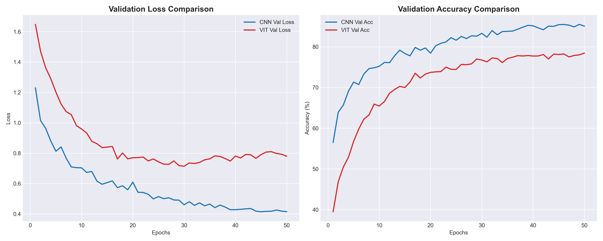
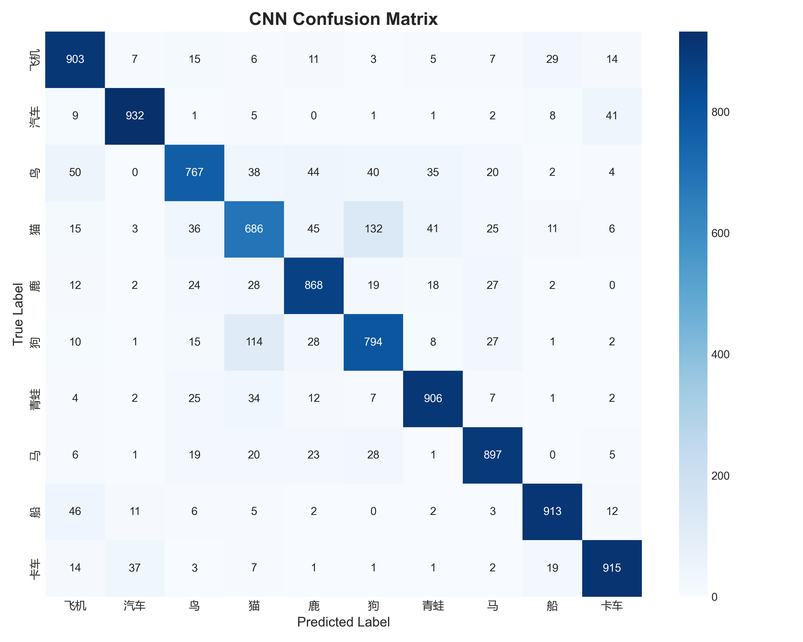
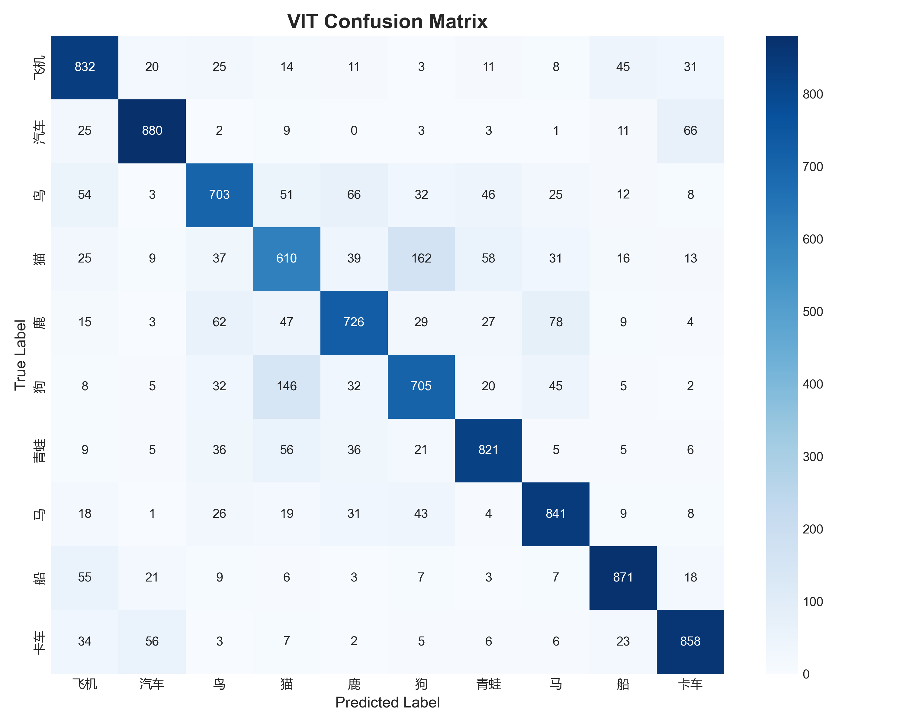
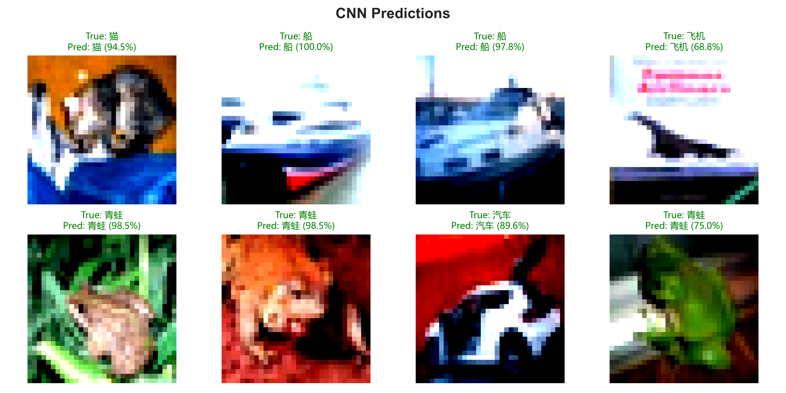

# CIFAR10: CNN vs ViT (From Scratch) 🧠⚡

> **"In the era of Transformers, is CNN dead?"**

卷积神经网络（CNN）在计算机视觉领域占据主导地位十余年，而后能捕捉全局特征的视觉Transformer（ViT）也慢慢成了研究热点。
本项目从零手写了轻量级 CNN 与 Vision Transformer (ViT)，在 CIFAR-10 数据集上进行了严格控制变量的 50-epoch 对比实验。

**结论是：在无预训练、50 个 Epoch 的限制下，经典的 CNN 凭借先验归纳偏置（Inductive Bias）在收敛速度和最终精度上略微领先，但 Vision Transformer 依然展现出了极强的竞争力，两者差距在50Epoch下并不悬殊。**

## ✨ 核心特性 (Features)

- **纯手写实现**：不依赖 `torchvision.models` 的现成架构，CNN 的卷积块与 ViT 的 Patch Embedding、Transformer Block 均从零手写。
- **工业级训练管线**：包含数据增强（RandomCrop/Flip）、Cosine Annealing 学习率调度、模型自动保存机制。
- **严谨的对照实验**：控制变量，公平对比两种范式在相同数据与超参下的表现。
- **全自动化可视化**：内置脚本一键生成 Loss 对比曲线、混淆矩阵与预测示例图。

## 📁 项目结构 (Project Structure)

```text
CIFAR10-CNN-vs-ViT/
├── configs.py           # 超参数配置 (Argparse)
├── data_loader.py       # 数据下载、增强与 DataLoader
├── models/
│   ├── __init__.py
│   ├── cnn.py           # 手写轻量级 CNN
│   └── vit.py           # 手写 Vision Transformer
├── train.py             # 训练脚本 (自动保存 best model 与 history)
├── evaluate.py          # 测试集评估脚本
├── plot_results.py      # 读取 history.json 并生成可视化图表
├── smoke_test.py        # 本地 CPU 快速冒烟测试
├── utils.py             # 随机种子、设备获取等工具
├── requirements.txt
├── data/                # 自动下载数据集 (不提交至 Git)
└── checkpoints/         # 权重与日志保存 (不提交至 Git)
```

## 🛠️ 快速开始 (Quick Start)

### 1. 环境准备

```bash
pip install -r requirements.txt
```

### 2. 本地冒烟测试 (Smoke Test)

在消耗算力前，先用随机张量验证网络结构是否存在维度错误：

```bash
python smoke_test.py
```

### 3. 模型训练

默认训练 50 个 Epoch，自动下载 CIFAR-10 数据集：

```bash
# 训练 CNN
python train.py --model cnn --epochs 50

# 训练 ViT
python train.py --model vit --epochs 50
```

### 4. 测试集评估与出图

```bash
python evaluate.py --model cnn
python evaluate.py --model vit
python plot_results.py
```

## 📊 实验结果与对比 (Results & Comparison)

我们在 CIFAR-10 数据集上（5万张训练图，1万张测试图），使用相同的训练配置（AdamW 优化器、Cosine Annealing 学习率调度、统一的数据增强），从头（From Scratch）训练了两个模型各 50 个 Epoch。

### 1. 收敛曲线对比



- **收敛速度**：CNN 在训练初期（前 10 个 Epoch）收敛极快，验证集准确率迅速攀升；而 ViT 由于缺乏卷积的局部归纳偏置，需要更长的时间“预热”来学习视觉特征。
- **最终精度**：在 50 个 Epoch 结束时，CNN 的验证集准确率达到了约 **83%**，而 ViT 达到了约 **78%**。两者相差约 5 个百分点，ViT 在后期依然保持上升趋势，并未出现严重的过拟合。

### 2. 混淆矩阵对比 (Confusion Matrix)

<p align="center">
  
  
</p>

- **CNN 的表现**：对角线非常清晰。在容易混淆的类别（如“猫”与“狗”、“鹿”与“马”）上，CNN 表现出了更高的辨识度。
- **ViT 的表现**：整体分类能力同样很强，但在“猫”和“狗”之间出现了相对多一些的误判（如 ViT 图中猫误判为狗的数值为 162，而 CNN 为 132）。这说明在小数据集上，ViT 提取细粒度局部特征的能力依然略逊于 CNN。

### 3. 真实预测可视化 (Prediction Examples)

<p align="center">
  
  
</p>

- 从预测结果看，面对低分辨率（32x32）的图片，两个模型都能以较高的置信度（大多在 90% 以上）给出正确的预测，证明了纯手写架构的特征提取能力。

## 🎓 工程反思 (Conclusion)

在计算机视觉领域，Vision Transformer (ViT) 确实拥有更高的容量上限，但这是以海量数据和算力为代价的。**在 CIFAR-10 这种小数据集上，由于没有 ImageNet 级别的预训练权重加持，ViT 的表现虽然令人惊喜（追到了 78%），但 CNN 依然是性价比最高、最稳妥的基线模型。** 架构的选择永远需要与数据规模相匹配。

## 📝 声明与致谢 (Acknowledgements)

The initial inspiration for this comparative study originated from a university AI course assignment. The entire codebase has been extensively restructured, modernized with data augmentation and learning rate scheduling, and implemented from scratch for a rigorous experimental comparison.

## 📄 License

[MIT License](LICENSE)

